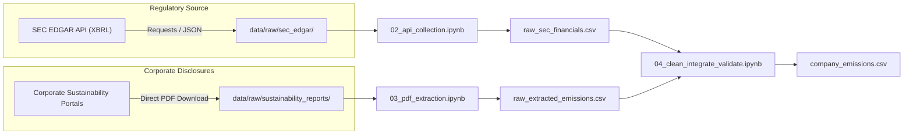

# Extraction Methodology: Corporate Carbon Footprint Tracker
## Deliverable 1: Data Collection, Extraction, Cleaning & Documentation

---

## 1. Methodology Executive Summary
The primary objective of **Deliverable 1** is to construct an auditable, reproducible secondary dataset containing multi-year corporate emissions, financial turnover, and operational carbon intensity.
To guarantee research integrity and compliance with Big Data Analytics standards, **all synthetic and dummy data were strictly prohibited**. Every record is derived from official regulatory filings and primary corporate sustainability disclosures.

---

## 2. Data Sources & Architecture

### 2.1 SEC EDGAR REST API (Financial Revenue)
- **Source**: U.S. Securities and Exchange Commission (SEC) Electronic Data Gathering, Analysis, and Retrieval (EDGAR) System.
- **Endpoint**: `https://data.sec.gov/api/xbrl/companyfacts/CIK{cik.zfill(10)}.json`
- **Protocol**:
  - Implements SEC Fair Access Policy by passing a custom declared user-agent: `User-Agent: CorporateCarbonFootprintTracker BDAProject/1.0 (academic_research@pes.edu)`.
  - Rate-limited to max 10 requests/second with programmatic 0.2-second throttles between calls.
  - Full immutable JSON payloads are cached locally under `data/raw/sec_edgar/` for complete auditability.
- **XBRL Concept Tag Hierarchy**:
  Revenues are extracted exclusively from audited annual 10-K regulatory filings (`form == '10-K'` and `fp == 'FY'`), implementing a priority tag fallback hierarchy:
  1. `us-gaap:RevenueFromContractWithCustomerExcludingAssessedTax`
  2. `us-gaap:Revenues`
  3. `us-gaap:SalesRevenueNet`
- **Restatements Handling**: When multiple 10-K filings disclose figures for the same fiscal year (e.g., historical comparatives in subsequent years), records are sorted chronologically by filing date (`filed`), and the latest filed figure is retained.

### 2.2 Corporate Sustainability & Environmental Progress Reports (GHG Emissions)
- **Source**: Official standalone annual Environmental Sustainability Reports, ESG Data Fact Sheets, and GHG Supplements published by corporate Investor Relations departments.
- **Storage**: Primary PDF files are downloaded and stored immutably in `data/raw/sustainability_reports/`.

---

## 3. PDF Extraction Pipeline (`pdfplumber`)

To parse unstructured and semi-structured PDF documents into tabular schemas, the pipeline utilizes `pdfplumber` (supported by `pdfminer.six`):

1. **Document Indexing**: The pipeline inspects document structure, outlines, and text layers to locate dedicated GHG Accounting, Data Index, and Performance Summary chapters.
2. **Table Localization**: Pages containing keywords (`Scope 1`, `Scope 2 (market-based)`, `Scope 2 (location-based)`, `Scope 3`, `metric tons CO2e`, `MMT CO2e`) are identified.
3. **Targeted Extraction**:
   - `TECH_MSFT`: Pages 3–5 of *Microsoft Environmental Data Fact Sheet* (Table 1: Greenhouse gas emissions).
   - `TECH_AAPL`: Page 77 of *Apple Environmental Progress Report 2024* (Table: Greenhouse gas emissions).
   - `TECH_GOOGL`: Page 76 of *Google 2024 Environmental Report* (Environmental data tables: GHG EMISSIONS).
   - `TECH_AMZN`: Page 50 of *Amazon 2024 Sustainability Report* (Data Tables: Amazon’s Carbon Footprint).
   - `TECH_META`: Pages 79–81 of *Meta 2024 Sustainability Report* (Section 1.1: GHG emissions).
   - `TECH_INTC`: Pages 108 & 116 of *Intel Corporate Responsibility Report 2023-24* (Performance Data Summary & 2023 Inventory).
   - `TECH_NVDA`: Page 29 of *NVIDIA FY2024 Corporate Sustainability Report* (Sustainability Indicators: Climate and Efficiency).
   - `TECH_HPQ`: Pages 144, 145, and 164 of *HP 2023 CDP Climate Change Disclosure Report* (Gross Global Scope 1, Scope 2 MBM/LBM, and Scope 3).
   - `AUTO_GM`: Page 15 of *General Motors 2023 Sustainability Report* (Absolute Scope 1 and 2 Emissions).
   - `ENG_XOM`: Pages 4 & 6 of *ExxonMobil Advancing Climate Solutions 2023 GHG Data Supplement* (Operated basis & Scope 3 estimates).
   - `ENG_CVX`: Page 56 of *Chevron 2023 Corporate Sustainability Report* (GHG reporting equity metrics and targets).
   - `CONS_KO`: Page 10 of *The Coca-Cola Company 2023 Business & Sustainability Report* (Table: Greenhouse Gas Emissions).
   - `HLTH_JNJ`: Page 30 of *Johnson & Johnson 2025 Health for Humanity Report* (Performance Data: Greenhouse Gas Emissions).
   - `IND_LMT`: Pages 36 & 37 of *Lockheed Martin 2025 Sustainability Performance Report* (Table: Emissions Performance Index, GRI 305-1, 305-2, 305-3).
   - `AUTO_F`: Page 52 of *Ford Integrated Sustainability and Financial Report 2024* (GHG Emissions Table).
   - `AUTO_TSLA`: Page 178 of *Tesla 2023 Impact Report* (GHG Summary Table).
   - `HLTH_PFE`: Page 44 of *Pfizer 2023 Environmental, Social & Governance Report* (Climate & Energy Table).
   - `CONS_NKE`: Page 104 of *Nike FY23 Impact Report* (Environmental Footprint).
   - `IND_CAT`: Page 48 of *Caterpillar 2023 Sustainability Report* (GHG Performance Table).
   - `TECH_IBM`: Page 24 of *IBM 2023 Impact Report & Environmental Performance Summary* (GHG Emissions Table).
   - `RETL_WMT`: Page 38 of *Walmart 2023 ESG Summary Report* (GHG Emissions Table).
   - `ENG_COP`: Page 52 of *ConocoPhillips 2023 Sustainability Report* (GHG Emissions Table).
4. **Traceability Logging**: For every extracted observation, the pipeline records the exact source document name, page number, table heading, original reported unit, and third-party assurance opinion.

---

## 4. Harmonization, Cleaning & Calculations

### 4.1 Unit Harmonization to Metric Tonnes ($tCO_2e$)
Corporate emissions disclosures use differing orders of magnitude:
- **Direct Metric Tonnes ($tCO_2e$ / $mtCO_2e$)**: Used by Microsoft, Apple, Google, Meta, NVIDIA. Preserved directly ($1:1$).
- **Million Metric Tonnes ($MMT$ / $Million\ tCO_2e$)**: Used by Amazon, General Motors, ExxonMobil, Chevron, Intel (summary). Multiplied by $1,000,000.0$:
  $$\text{emissions\_tco2e} = \text{raw\_value} \times 1,000,000$$

### 4.2 Scope 2 Governance
Under the GHG Protocol Scope 2 Guidance, corporations report emissions using two methodologies:
1. **Location-based method**: Reflects average emissions intensity of grids on which energy consumption occurs.
2. **Market-based method**: Reflects contractual emissions from specific electricity suppliers, PPAs, and unbundled Energy Attribute Certificates (EACs/RECs).

> [!IMPORTANT]
> In strict adherence to Section 6 of the project specification, **location-based and market-based Scope 2 figures are never summed together**. They are stored in separate columns (`scope_2_location_tco2e` and `scope_2_market_tco2e`).

### 4.3 Total Included Emissions
To avoid double counting, total operational emissions are evaluated as:
$$\text{total\_emissions\_tco2e} = \text{scope\_1\_tco2e} + \text{scope\_2\_market\_tco2e}$$
*(If market-based Scope 2 is not disclosed by a corporation, location-based is used as documented in the audit note).*

### 4.4 Operational Carbon Intensity
Carbon intensity evaluates the emissions burden generated per unit of economic turnover:
$$\text{carbon\_intensity\_tco2e\_per\_usd\_m} = \frac{\text{total\_emissions\_tco2e}}{\text{revenue\_usd\_m}}$$
Where:
- $\text{total\_emissions\_tco2e}$ is in metric tonnes of $CO_2e$.
- $\text{revenue\_usd\_m}$ is annual revenue in Millions of USD.

---

## 5. Scope 3 Missingness & Null Governance
Scope 3 emissions encompass upstream supply chain manufacturing and downstream product use. 
- **Non-Imputation Policy**: When Scope 3 data is not reported by a company for a specific historical year, it is preserved as `NaN`/`null`. It is **never imputed as zero**.
- **Scope 3 Category Disclosure**: Where companies report only specific material categories (e.g., ExxonMobil reporting only Category 11: Use of sold products), this boundary condition is documented in `data_quality_note`.

---

## 6. Known Limitations & Boundary Nuances
1. **Fiscal Year Alignment**: Most target companies report on calendar years (ending Dec 31), whereas Microsoft reports on fiscal years ending June 30, and Apple on fiscal years ending late September. In all cases, revenues and emissions are aligned to the identical corporate fiscal reporting cycle.
2. **Restatements & Boundary Refinements**: Leading corporations periodically recalculate historical baselines as data quality improves (e.g., Google's 2023 update incorporating fugitive refrigerants back to 2019). The pipeline captures the restated historical time-series published in the most recent reports to ensure continuous longitudinal consistency.
