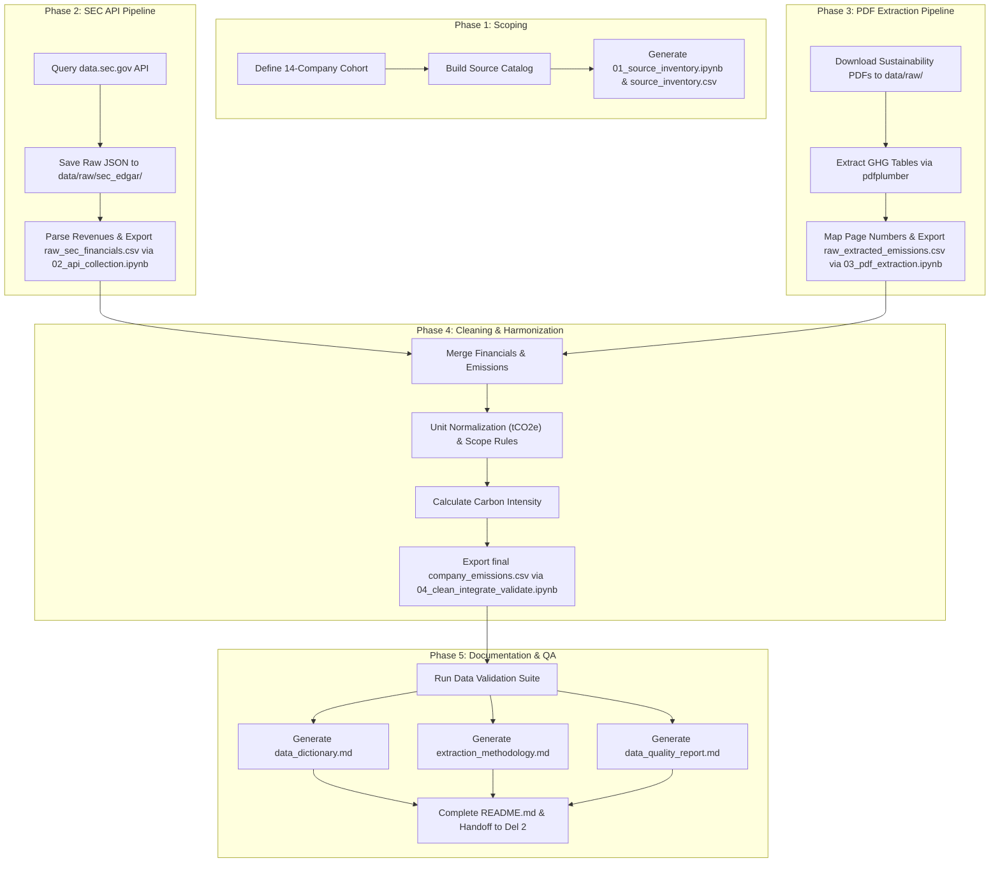

# Deliverable 1 Master Implementation Plan
## Corporate Carbon Footprint Tracker (Task EDA-1)

---

## 1. Project Overview & Scope
The objective of **Deliverable 1** is to build a verified, auditable, and standardized secondary dataset of corporate greenhouse gas (GHG) emissions across multi-year reporting periods.

- **Primary Goal**: Assemble `company_emissions.csv` capturing Scope 1, Scope 2 (both location-based and market-based), and Scope 3 emissions paired with official financial revenue and calculated carbon intensity.
- **Data Integrity Rule**: **Zero synthetic or dummy data.** All values are sourced via official REST APIs (SEC EDGAR) and programmatic PDF extraction (`pdfplumber`) from official corporate sustainability reports.
- **Boundary**: Data engineering, extraction, cleaning, validation, and documentation only. Machine learning models (Deliverable 2) are excluded.

---

## 2. Target Company Cohort & Reporting Periods
We will collect data across **5 reporting years (2019–2023)** for **14 major public corporations** spanning **4 distinct sectors**. These companies were selected because they have audited SEC 10-K filings and publish comprehensive standalone sustainability reports with full Scope 1–3 disclosures:

| Sector | Company Name | Ticker | SEC CIK | Primary Disclosures |
| :--- | :--- | :--- | :--- | :--- |
| **Technology** | Microsoft Corporation | `MSFT` | `0000789019` | Environmental Sustainability Report |
| **Technology** | Alphabet Inc. (Google) | `GOOGL`| `0001652044` | Environmental Report & Data Center GHG Data |
| **Technology** | Apple Inc. | `AAPL` | `0000320193` | Environmental Progress Report |
| **Technology** | Amazon.com, Inc. | `AMZN` | `0001018724` | Sustainability Report / Carbon Methodology |
| **Technology** | Meta Platforms, Inc. | `META` | `0001326801` | Sustainability Report |
| **Energy** | ExxonMobil Corporation| `XOM`  | `0000034088` | Advancing Climate Solutions Progress Report |
| **Energy** | Chevron Corporation | `CVX`  | `0000093410` | Corporate Sustainability Report |
| **Energy** | ConocoPhillips | `COP`  | `0001163165` | Sustainability Report |
| **Retail & Consumer** | Walmart Inc. | `WMT`  | `0000104169` | ESG Summary Report |
| **Retail & Consumer** | Target Corporation | `TGT`  | `0000027419` | Sustainability & Governance Report |
| **Retail & Consumer** | Nike, Inc. | `NKE`  | `0000320187` | Impact Report |
| **Automotive & Industrial** | Tesla, Inc. | `TSLA` | `0001318605` | Impact Report |
| **Automotive & Industrial** | Ford Motor Company | `F`     | `0000037996` | Integrated Sustainability and Financial Report |
| **Automotive & Industrial** | General Motors Company| `GM`    | `0001467858` | Sustainability Report |

*Dataset volume*: 14 companies × 5 years = **70 standardized company-year observations**, providing strong historical depth for Deliverable 2 time-series forecasting and intensity classification.

---

## 3. Master Dataset Schema (`company_emissions.csv`)

Every record will follow this 20-field schema mandated by Section 3 of the project specification:

| Field Name | Type | Description / Formatting Standards |
| :--- | :--- | :--- |
| `company_id` | String | Internal unique identifier (e.g., `TECH_MSFT`, `ENG_XOM`) |
| `company_name` | String | Standardized legal corporate name |
| `ticker_or_lei` | String | Primary stock ticker (e.g., `MSFT`) |
| `sector` | String | GICS-aligned sector (`Technology`, `Energy`, `Consumer Discretionary`, `Consumer Staples`, `Automotive`) |
| `reporting_year` | Integer | Reporting fiscal year (`2019` to `2023`) |
| `scope_1_tco2e` | Float | Direct emissions in metric tonnes of $CO_2e$ |
| `scope_2_location_tco2e`| Float | Location-based grid Scope 2 emissions ($tCO_2e$) |
| `scope_2_market_tco2e` | Float | Market-based contractual Scope 2 emissions ($tCO_2e$) |
| `scope_3_tco2e` | Float/Null| Total value chain Scope 3 emissions ($tCO_2e$); null if not disclosed |
| `revenue_value` | Float | Revenue as reported in SEC 10-K |
| `revenue_currency` | String | Currency code (`USD`) |
| `revenue_usd_m` | Float | Annual revenue in Millions of USD |
| `total_emissions_tco2e` | Float | Scope 1 + Scope 2 (Market-based if available, else Location-based) |
| `carbon_intensity_tco2e_per_usd_m`| Float | $\frac{\text{Total Included Emissions }(tCO_2e)}{\text{Revenue (USD Millions)}}$ |
| `reporting_boundary` | String | Consolidation boundary (e.g., *Operational Control*, *Financial Control*) |
| `source_title` | String | Primary source report/filing title |
| `source_url` | String | URL to source PDF or SEC EDGAR filing accession |
| `source_page_or_table`| String | Specific page number and table identifier (e.g., `Page 42, Table 3.1`) |
| `assurance_status` | String | External assurance level (`Third-party Assured`, `Limited Assurance`, `Unassured`) |
| `data_quality_note` | String | Audit trail, boundary notes, or restatement flags |

---

## 4. Repository Architecture
The project files will be organized under `c:\Sem6\BDA\corporate-carbon-tracker\`:

```
corporate-carbon-tracker/
│
├── data/
│   ├── raw/
│   │   ├── sec_edgar/                  # Immutable raw SEC XBRL API JSON files
│   │   │   ├── CIK0000789019.json
│   │   │   └── ...
│   │   ├── sustainability_reports/     # Official downloaded PDF reports
│   │   │   ├── MSFT_Sustainability_2023.pdf
│   │   │   └── ...
│   │   └── source_inventory.csv        # Metadata registry of all sources & URLs
│   │
│   ├── interim/
│   │   ├── raw_sec_financials.csv      # Extracted 10-K revenue figures
│   │   └── raw_extracted_emissions.csv # Raw table values prior to harmonization
│   │
│   └── processed/
│       └── company_emissions.csv       # Final production dataset
│
├── notebooks/
│   ├── 01_source_inventory.ipynb       # Inventory creation & coverage mapping
│   ├── 02_api_collection.ipynb        # SEC EDGAR REST API querying & JSON parsing
│   ├── 03_pdf_extraction.ipynb         # pdfplumber table extraction & text mining
│   └── 04_clean_integrate_validate.ipynb # Unit normalization, joining, intensity, QA tests
│
├── docs/
│   ├── data_dictionary.md              # Field specifications, formulas, missing value codes
│   ├── extraction_methodology.md       # API protocols, PDF parsing heuristics, limitations
│   └── data_quality_report.md          # Coverage matrices, missingness checks, reconciliation
│
└── README.md                           # Environment setup, execution guide, architecture summary
```

---

## 5. Five-Phase Implementation Roadmap



### Phase 1: Source Scoping & Inventory Registry
- **Step 1.1**: Build `corporate-carbon-tracker/` directory tree.
- **Step 1.2**: Author `notebooks/01_source_inventory.ipynb` to establish the company registry, sector taxonomy, CIKs, and official PDF report URLs.
- **Step 1.3**: Save `data/raw/source_inventory.csv`.

### Phase 2: Live SEC EDGAR API Collection
- **Step 2.1**: Author `notebooks/02_api_collection.ipynb`.
- **Step 2.2**: Implement an SEC-compliant query script using custom `User-Agent` headers targeting endpoint:
  `https://data.sec.gov/api/xbrl/companyfacts/CIK{cik.zfill(10)}.json`
- **Step 2.3**: Save full immutable JSON responses to `data/raw/sec_edgar/`.
- **Step 2.4**: Extract audited annual revenues (`Revenues` / `SalesRevenueNet`) for FY2019–FY2023 in USD Millions.
- **Step 2.5**: Output `data/interim/raw_sec_financials.csv`.

### Phase 3: Sustainability Report Acquisition & `pdfplumber` Extraction
- **Step 3.1**: Author `notebooks/03_pdf_extraction.ipynb`.
- **Step 3.2**: Download official sustainability reports to `data/raw/sustainability_reports/`.
- **Step 3.3**: Use `pdfplumber` to locate GHG accounting tables. Extract:
  - Scope 1 emissions
  - Scope 2 location-based emissions
  - Scope 2 market-based emissions
  - Scope 3 categories and totals
  - Disclosed reporting units (metric tonnes, thousand tonnes, million tonnes)
  - Reporting boundaries & assurance statements
- **Step 3.4**: Log every value's exact source PDF name, page number, and table title.
- **Step 3.5**: Output `data/interim/raw_extracted_emissions.csv`.

### Phase 4: Cleaning, Harmonization & Carbon Intensity
- **Step 4.1**: Author `notebooks/04_clean_integrate_validate.ipynb`.
- **Step 4.2**: Harmonize units to metric tonnes of $CO_2e$ ($tCO_2e$):
  - If reported in kilotonnes ($kt$) or thousand tonnes $\to$ multiply by $1,000$.
  - If reported in million tonnes ($Mt$) $\to$ multiply by $1,000,000$.
- **Step 4.3**: Enforce Scope rules:
  - Scope 2 location-based and market-based figures are strictly kept separate (never summed together).
  - Scope 3 missingness is explicitly coded (`ND` for Not Disclosed, `NA` for Not Applicable, never imputed as 0).
- **Step 4.4**: Join emissions with SEC revenue by `[company_id, reporting_year]`.
- **Step 4.5**: Compute total emissions and carbon intensity:
  $$\text{Total Emissions } (tCO_2e) = \text{Scope 1} + \text{Scope 2 (Market-based)}$$
  $$\text{Carbon Intensity } = \frac{\text{Total Emissions } (tCO_2e)}{\text{Revenue (USD Millions)}}$$
- **Step 4.6**: Export validated `data/processed/company_emissions.csv`.

### Phase 5: Quality Audit & Deliverable Documentation
- **Step 5.1**: Run rigorous validation checks:
  - Range and non-negativity checks ($> 0$).
  - Missingness analysis per company, year, and scope.
  - Cross-year consistency audits (identifying restatements or sudden boundary changes).
- **Step 5.2**: Generate `docs/data_dictionary.md` containing all schema definitions, formulas, and valid ranges.
- **Step 5.3**: Generate `docs/extraction_methodology.md` detailing SEC API endpoints, PDF extraction regex/table heuristics, and audit rules.
- **Step 5.4**: Generate `docs/data_quality_report.md` detailing completeness matrices and validation results.
- **Step 5.5**: Write comprehensive `README.md` with full reproduction steps.

---

## 6. Execution Order & Step-by-Step Milestones

Once approved, we will execute each step sequentially:
1. **Milestone 1**: Project folders setup + `01_source_inventory.ipynb` + `source_inventory.csv`.
2. **Milestone 2**: `02_api_collection.ipynb` + SEC EDGAR API downloads + `raw_sec_financials.csv`.
3. **Milestone 3**: `03_pdf_extraction.ipynb` + PDF report downloads + `pdfplumber` parsing + `raw_extracted_emissions.csv`.
4. **Milestone 4**: `04_clean_integrate_validate.ipynb` + data cleaning + `company_emissions.csv`.
5. **Milestone 5**: Full documentation suite (`data_dictionary.md`, `extraction_methodology.md`, `data_quality_report.md`, `README.md`).
